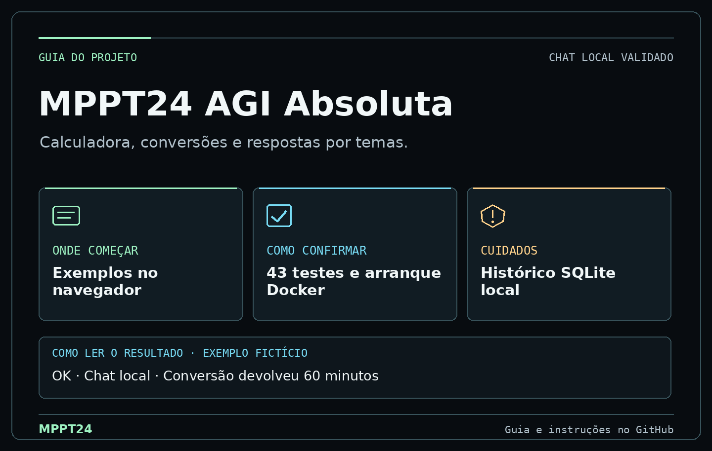

# Guia de MPPT24 AGI Absoluta

**Estado:** Chat local validado.

Calculadora, conversões e respostas por temas.

[](docs/guia-visual.png)

## Onde começar

Segue [Experimentar](README.md#experimentar) e escolhe um dos exemplos no navegador.

## Como confirmar

Corre a suite indicada no README ou consulta «Testar o AGI Absoluta» em **Actions**. A CI também verifica o arranque em Docker e uma resposta pela API.

## Como ler os registos

`docker compose logs mppt24-agi` mostra o arranque e os pedidos HTTP. Para confirmar uma versão, abre a execução do commit em **Actions**. O histórico de conversas fica separado, em SQLite.

### Exemplo fictício

```text
OK · Chat local · Conversão devolveu 60 minutos
```

Lê pela ordem **resultado**, **etapa** e **detalhe**. Para investigar uma falha, confirma primeiro a data e a versão, depois abre o primeiro passo que falhou.

## Cuidados

O serviço destina-se a uso local. Evita dados privados nas mensagens. A tag antiga `v1.3.0` tem um erro de sintaxe confirmado. Para testar a base atual, segue o README da `main`.

Vê também o [infográfico da aplicação](docs/infografico.png).
